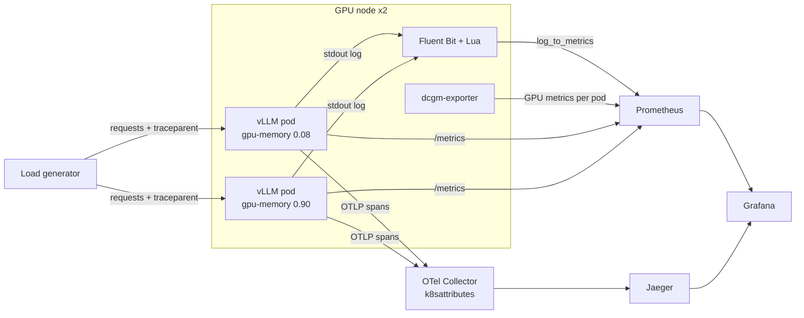

# Inference Is a Black Box: GPU-Aware Observability with Fluent Bit and OpenTelemetry

Companion lab for the KubeCon + CloudNativeCon North America 2026 Observability Day talk.

Two vLLM pods serve the same model on the same GPU type with the same traffic. One reserves 8% of GPU memory, the other 90%. The GPU memory chart shows two flat lines and cannot tell you which one is in trouble. The inference server's own signal (KV cache usage, queue time) can, and this lab shows how to collect it per pod and join it with GPU metrics and traces.

**The pod is the join key.** Stamp the same `pod` and `namespace` on three signals and they become one Grafana query:

| Signal | Collected by | Pod label |
|--------|--------------|-----------|
| GPU metrics | dcgm-exporter in Kubernetes mode (`--kubernetes=true`) | `exported_pod` |
| Serving logs turned into metrics | Fluent Bit, a short Lua filter, `log_to_metrics` | `pod_name` |
| Traces, two hops (client, then vLLM) | OpenTelemetry Collector `k8sattributes`, stored in Jaeger | `k8s.pod.name` |



## What you get

- An EKS Auto Mode cluster with a GPU NodePool (g5 or g6, one NVIDIA GPU per node), built with one Terraform configuration.
- Prometheus and Grafana (kube-prometheus-stack), Fluent Bit, the OpenTelemetry Collector and Jaeger.
- Two vLLM deployments serving `facebook/opt-125m`, and a load generator that sends the same traffic to both.
- A four-screen guided walkthrough in Grafana ([DEMO.md](DEMO.md)), plus a single-screen dashboard and a deep-dive dashboard for exploring.

## Prerequisites

| Need | Notes |
|------|-------|
| An AWS account you can create VPCs, EKS clusters and IAM roles in | Use a sandbox account, not production |
| GPU quota | Service Quotas, EC2, "Running On-Demand G and VT instances": at least 16 vCPUs in your Region (two g5 or g6 nodes, xlarge or 2xlarge) |
| A Region with g5 or g6 instances | Default `eu-central-1`; set `region` in `terraform.tfvars` to change it |
| Terraform >= 1.5, AWS CLI v2, kubectl, Python 3, curl | Tested on macOS and Linux |

**Cost:** roughly USD 2.40 per hour while it runs (two GPU nodes, the EKS control plane, a NAT gateway). Tear it down when you finish (see [Clean up](#clean-up)). The GPU NodePool replaces nodes after 24 hours (`expireAfter: 24h`) but never scales to zero while vLLM runs, so the lab bills until you destroy it.

## Deploy

```bash
git clone https://github.com/danilosilvase/gpu-observability-kubecon-na-2026.git
cd gpu-observability-kubecon-na-2026/terraform

cp terraform.tfvars.example terraform.tfvars
# Edit terraform.tfvars: set admin_cidrs to your public IP (curl -s https://checkip.amazonaws.com)/32.
# Set aws_profile only if you use a named profile; otherwise your current credentials are used.
# The scripts use your shell's credentials: if you set aws_profile, also export AWS_PROFILE=<same profile>.

terraform init
terraform apply -target=module.eks    # VPC and cluster first: the Kubernetes providers need the cluster
terraform apply                       # platform, GPU NodePool, workloads, dashboards
./validate.sh                         # expect "15 passed / 0 failed"
```

The first apply takes most of the time (the EKS cluster). The second one waits for the GPU nodes to start and both vLLM pods to pull their image. The trace and Fluent Bit checks in `validate.sh` need traffic; if they fail on a fresh cluster, run `../demo/load.sh`, wait a minute and run `./validate.sh` again.

If you set a non-default `region` or `cluster_name`, export them for the scripts: `export REGION=us-west-2 CLUSTER=my-cluster`.

**Already have a cluster?** `manifests/deploy.sh` applies the same files onto any cluster with NVIDIA GPU nodes and kube-prometheus-stack in the `observability` namespace. See [manifests/README.md](manifests/README.md).

## Run the demo

```bash
cd ..                 # repository root
demo/start.sh         # tunnels to Grafana :3000, Jaeger :16686, Prometheus :9090; opens screens 4 and 1
demo/check.sh         # expect "9 OK, 0 FAIL"
demo/load.sh          # 20 minutes of identical traffic to both pods
```

Grafana login: `admin` / `gpu-obs-demo`. If you set `grafana_admin_password`, also `export GRAFANA_PASSWORD=<same>` for the demo scripts. Follow the four screens in [DEMO.md](DEMO.md). The constrained pod's KV cache fills about 90 seconds after the load starts.

Other dashboards, under Dashboards in Grafana:

- **GPU inference: which pod is in trouble?** (all three signals on one screen).
- **GPU inference: deep dive** (every panel, including the native vLLM `/metrics` cross-check).

Helper scripts in `demo/`:

| Script | Does |
|--------|------|
| `start.sh` | Points kubectl at the cluster, starts self-healing port-forwards, opens the walkthrough |
| `check.sh` | Pre-flight: pods, the three signals, dashboards |
| `load.sh` | (Re)starts the 20-minute load |
| `trace.sh` | Opens the slowest recent request on the constrained pod in Grafana |
| `cardinality.sh` | Counts GPU series now and over the last hour (see [the cardinality notes](manifests/50-prometheus/CARDINALITY-DEMO.md)) |
| `stop.sh` | Stops the port-forwards and the load. The cluster keeps running |

## What we measured

Same traffic to both pods (192 long requests in flight each), NVIDIA A10G 24 GB on g5.xlarge:

| | Constrained (0.08) | Over-provisioned (0.90) |
|--|--|--|
| GPU memory (DCGM) | 2.0 GB, flat | 20.6 GB, flat |
| KV cache peak (from the log) | 100% | about 31% |
| Requests running / waiting | about 49 / 143 | about 191 / 0 |
| Time to first token (average) | about 5.9 s | about 0.08 s |

GPU memory never moves; the KV cache and time to first token tell the story. Our rule of thumb for sizing `--gpu-memory-utilization` (ours, not vLLM's): look at the peak KV cache under real traffic. Above 90% the pod is memory-constrained; below 40% it is over-provisioned. These numbers are for a small model on one GPU and will differ for yours; reuse the method, not the values.

## Clean up

```bash
demo/stop.sh
cd terraform && terraform destroy
```

## Repository layout

| Path | What |
|------|------|
| `terraform/` | VPC, EKS Auto Mode cluster, kube-prometheus-stack, then everything in `manifests/` |
| `manifests/` | One file per component; the single source that Terraform and `deploy.sh` both apply |
| `manifests/60-grafana/` | Dashboards (JSON) and the Python that generates them |
| `demo/` | Scripts to run and check the demo |
| [DEMO.md](DEMO.md) | The four-screen walkthrough |

## Notes

- **Nothing is public except the EKS API**, which is limited to `admin_cidrs`. All Services are ClusterIP, with no Ingress or load balancer; Grafana, Jaeger and Prometheus are reached through `kubectl port-forward`. That is also why the Grafana password is a simple default.
- **EKS Auto Mode ships the NVIDIA driver and device plugin**, so dcgm-exporter runs standalone. Do not install the NVIDIA GPU Operator on Auto Mode. On other clusters, use the GPU Operator's bundled dcgm-exporter with the same settings.
- **Cardinality:** `DCGM_EXPORTER_KUBERNETES_ENABLE_POD_LABELS` is `false` on purpose. The pod name is kept (it is the join key); everything else that churns is dropped. See [CARDINALITY-DEMO.md](manifests/50-prometheus/CARDINALITY-DEMO.md).
- **Why parse the log when vLLM has `/metrics`?** vLLM does expose KV cache usage natively, and you should scrape it if you can. The Fluent Bit and Lua path shows the technique for servers that only log these values; the deep-dive dashboard cross-checks the two.
- **Traces have two hops:** the load generator sends a client span and a `traceparent` header, and vLLM continues the trace. In Grafana, the link icon on any span opens that pod's GPU memory and KV cache (`tracesToMetrics` in `manifests/60-grafana/jaeger-datasource.yaml`).
- **Versions:** vLLM v0.30.0 (OpenTelemetry tracing needs 0.10.2 or later), Fluent Bit 5.1.3, dcgm-exporter 4.8.4, kube-prometheus-stack 65.5.0, Kubernetes 1.37.
- **Dashboards are generated.** Edit `manifests/60-grafana/build_dashboard.py` or `build_walkthrough.py`, then from `manifests/60-grafana/`:
  `python3 build_dashboard.py gpu-inference-dashboard.json gpu-inference-deep-dive.json` and `python3 build_walkthrough.py walk`.

## Troubleshooting

| Symptom | Fix |
|---------|-----|
| `kubectl` or `terraform` hangs talking to the cluster | Your public IP changed. Update `admin_cidrs` in `terraform.tfvars`, then `terraform apply -target=module.eks` |
| vLLM pods stay `Pending` | GPU quota or capacity in your Region. Check the "G and VT" quota, or try another Region |
| Tiles say "No load yet" or "No traffic" | Nothing is sending requests. Run `demo/load.sh` |
| KV cache tiles say "Waiting for the first log line" | Fluent Bit restarted since the last load; it recovers within seconds of `demo/load.sh` |
| Grafana or Jaeger on localhost stops responding | `demo/start.sh` again (its tunnels restart themselves, this resets them) |

## Credits

This talk builds on an AWS GenAI observability session; thanks to its original authors.

## License

MIT. See [LICENSE](LICENSE).
